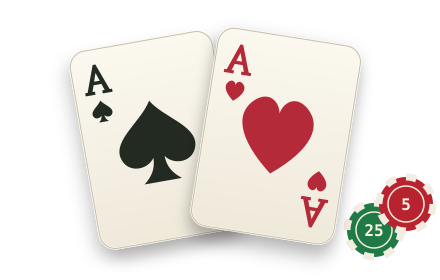

<p align="center">
  
</p>

<h1 align="center">Verve Poker</h1>

<p align="center">
  <b>English</b> · <a href="README.zh-CN.md">简体中文</a>
</p>

<p align="center">
  No-limit Texas Hold'em in your browser, made for phones first. Every player gets 1,000 a day,<br>
  plays six bots with their own styles or friends in a private room, and competes for the day's best on a shared leaderboard.
</p>

<p align="center">
  <a href="https://verve.vpoker.workers.dev"><b>▶ Play now</b></a>
</p>

---

## How it got here

The original game had the engine, the six bots, the chip-true table, practice play and private rooms with friends. **Sicheng Li** forked it ([sudo-sc/merlin-poker](https://github.com/sudo-sc/merlin-poker)) at `810bd62` and made money real within the game: balances, every bet and every payout are kept in a database on the server, and the day resets at midnight with a leaderboard. He also redesigned the lobby and the table and added sounds. His fork was merged back at `50fe9b8`, and some of the original's features came back with it. The sections below list what changed, what was added, what was kept from before, what was removed, and what is still unfinished.

### Changed

- **Regular play runs on the server.** A game against bots used to be dealt in your browser. Now each player gets a private table on the Verve server (a Cloudflare Durable Object), which deals, runs the bots and records everything. Practice still runs in the browser.
- **Money.** The daily allowance of 1,000 used to be kept in the browser. Now each player has a real balance in the database: 1,000 at the start of each day (US Eastern), checked by the server on every buy-in and cash-out.
- **Stakes.** The blind fields are replaced by three tables: 1/2 with a 200 minimum buy-in, 2/5 with 500, and 5/10 with 1,000. A stake you can't afford is greyed out.
- **Buying in and cashing out.** The fixed 买一手 +200 / 退一手 −200 buttons are replaced by one bank panel with a slider in steps of the minimum buy-in. A request runs at once if you aren't in a hand, and otherwise as soon as you fold or the hand ends.
- **Betting.** A 2×2 grid: Call and Raise pick the chips, Bet sends them, Fold folds. Raise opens a slider with Min. and All in at its ends and the 1/3 Pot, 1/2 Pot, 2/3 Pot and Pot presets under it, plus Custom: tap the amount and type it. When the chips picked come to more than the amount (a buy-in is all 25s), Bet pays the amount and the rest comes back as change. Pre-actions (Check/Fold, Check, Call Any) are buttons.
- **Chips.** Buy-ins arrive as 25s, and stacks are only rearranged when 自动整理筹码 (auto-tidy) is on.
- **End of a hand.** A regular or practice table waits for 继续游戏 (next hand) or 退出牌桌 (leave). The result stays in the middle of the table until the next hand. Leaving folds you if you're still in the hand and cashes your stack out to your balance.
- **Bots.** Each bot has a fixed id, and its displayed name comes from the database. Every table has its own copy of each bot, which buys its chips from the bank.
- **The table.** The dealer, small blind and big blind are marked with D, S and B chips beside the names. A 45-second ring counts down each turn, and your hand type is shown as you play. Cards are dealt one at a time, and the bots wait until every card has landed.
- **The player card.** Tapping a seat opens the same stats popup as the lobby's 查看数据 (view stats).
- **The lobby.** Your balance in large type, a name pill, a scrolling leaderboard, the stake tiles and flat buttons.
- **Sound.** The generated beep is replaced by sound files for your turn, the run-it-twice choice, every action, each card dealt, each board card, the payout and completed bank transactions.

### Added

- **Players without a sign-in.** Your browser keeps a random id and a secret token; the server stores only a hash of the token. You leave a name to play, can change it once, and can clear the account in 设置 (settings).
- **A database (Cloudflare D1).** It has these tables:
  - `players`: the day's players and balances.
  - `transactions`: a ledger of every buy-in, cash-out, bet and payout, which is the source of truth for every balance.
  - `games`: one row per player per hand.
  - `stats`: each player's totals for the day, with VPIP, PFR, steal, 3-bet, WSD and WWSF ratios.
  - `leaderboard`: the saved bests.

  See [DATABASE.md](DATABASE.md).
- **The leaderboard.** 今日最佳 (today's best) is live: balance plus chips at the table, among players who have played a hand today. 昨日最佳, 本周最佳, 本月最佳 and 历史最佳 (yesterday, this week, this month, all time) are saved at midnight. Ties go to more money, then the bigger biggest win, then the higher share of hands won, then chance.
- **查看数据.** Your stats for the day: hands, hands won, your biggest win with its five cards and hand type, and seven ratios, each with an explanation.
- **The day's close.**
  - **23:55 Eastern:** no new hands, and the tables send everyone back to the lobby.
  - **00:00:** a hand still running is overtime and gets a warning.
  - **00:05:** an overtime hand still running is called off and every bet is refunded.
  - **00:06:** the leaderboard is saved and the old day's data is deleted.

  Each new day, everyone starts again at 1,000.
- **English.** The whole game is in Chinese or English. The first time the page opens it asks which (选择语言 · Choose your language), and 设置 → 语言 (Settings → Language) changes it later. Each player sees the table in their own language, even in a friends room with players of both.
- **关于 (about).** What the game is and how a day goes.
- **设置 (settings).** 游戏音效 turns all sounds on or off. 机器人速度 (bot speed) offers 较慢, 中等 (the default) and 较快. 牌桌 picks the first or the second floor.
- **Developer tools.** `/d1` is a page for browsing the local database. `/audit` checks every balance against the ledger. Both only work on your own machine.
- **Tests.** Tests for the server, the money, the database writes, the day's close, the leaderboard, the sounds and your betting buttons: 86 in all.

### Kept from before

These were dropped in the fork and are back after the merge:

- **好友模式 (friends).** The lobby button opens the rooms people are in right now: tap one to join, with its password if it has one. Or type a room code to join it, or create a room (an empty code picks one at random) with an optional password; a new room plays at the stake picked in the lobby. You play under your own name. An invite link opened before leaving a name asks for one, then goes into the room. In a room, **记录** (records) has the invite link, the players (the owner can remove them) and the ledger.
- **Confirmations for Fold and All in.** Fold, and a Bet that puts your whole stack in, turn the buttons into 取消 + 确认 Fold / 确认 All in. Everything else goes straight through.
- **The bet presets.** 1/3 Pot, 1/2 Pot, 2/3 Pot, Pot and Custom, now on the raise slider.
- **The second floor and the blue walls.** 设置 → 牌桌 picks the first-floor meeting room (walnut table, houndstooth armchairs, blue walls under a pendant light) or the second-floor lounge (dark stone table, leather sofas, teal walls under a slatted ceiling with light strips). The fork had painted both casino green.
- **The bots' personalities.** A bot's card shows its avatar and how it plays, above its stats.
- **Deploying on every push to `main`**, through GitHub Actions (see [DEPLOY.md](DEPLOY.md)).

### Removed

- **Custom blinds.** Replaced by the three stakes.
- **The browser-side daily allowance.** Replaced by the server balance.
- **Seat swapping (和 TA 换座位).** It let players skip the blinds by changing seats.
- **The host's table reset.** It also cleared every player's chips.
- **Confirmations for Call, Check and ordinary bets.** Only Fold and All in still ask.
- **The 整理 (tidy) button.** Replaced by the 自动整理筹码 switch.
- **The table's top-bar extras.** The 主页 (home) button and the settings menu are gone, and hand hints are always on.
- **The win/loss banner.** The 这把 +N / −N line and the bust message are gone.

### Still in progress

- **Transfers between players** in a friends room aren't built.
- **The 记录 (records) page** is only open in a friends room. Elsewhere, stats are shown through 查看数据.
- **Known gaps:**
  - During a hand, 今日最佳 counts the stack a player had before that hand.
  - In a rare restart, a hand's chip rows could be written twice. The fix is planned.
  - The hand log still says 买一手 / 退一手 for buy-ins and cash-outs of any size.
  - The sound files aren't yet levelled to the same loudness.

## How to play

1. Open **[verve.vpoker.workers.dev](https://verve.vpoker.workers.dev)** (or http://127.0.0.1:8787 when running it locally) and tap the name pill to leave a name. Your balance for the day is 1,000.
2. Pick a stake and tap **进入游戏** (enter game). The bank panel opens: slide to the amount and tap **买入** (buy in). **练习模式** (practice) gives pretend chips that are never recorded.
3. To play friends, tap **好友模式**: pick a room from the list, or type a room code and tap **加入房间** (join) or **创建房间** (create). Send them the link from **记录**.
4. On your turn, tap chips or use **Call** / **Raise** to pick an amount, then **Bet** to send it. **Fold** folds. Fold and All in ask once more.
5. After a hand, tap **继续游戏** for the next one, or **退出牌桌** to leave. Leaving takes your chips back to your balance. A friends room deals the next hand by itself.
6. Tap your name in the lobby for **查看数据**, or tap a seat at the table to see that player's stats.

The day closes at midnight US Eastern. The next day you leave a name again and start at 1,000.

## For developers

A single page with plain ES modules and no build step. The page, the game server and the database are one Cloudflare Worker.

### Layout

```
index.html          page skeleton and the import map (written by tools/stamp.js)
css/                styles, loaded in numeric order; later files override earlier ones
js/
  main.js           entry: identity, the player row, restore the last mode
  config.js         constants: bots, timings (DEAL_STEP …), the server address
  settings.js       stakes, normal/practice, the table's floor
  state.js          shared runtime state, written through setX(); views register redraws on `view`
  player.js         the player row, stats, bot names and the leaderboard from the server
  cards.js          cards, shuffling, hand ranking, equity        ← pure logic, tested
  chips.js          chips: exact payment, change, tidying         ← pure logic, tested
  pots.js           main and side pots                            ← pure logic, tested
  table.js          queries and small operations on the table state
  engine.js         the dealer: dealing, betting rounds, all-in runouts, showdown, calling off a hand
  bots.js           bot strategy
  stats.js          per-player counts, and the games rows a hand writes
  talk.js           avatars, bot lines, emoji
  i18n.js           the player's language: tr() for the page's text, tx() for the table's (results, log, bot lines)
  lang-en.js        the English of every Chinese text
  fx.js             sounds, confetti, keeping the screen awake
  online.js         seat docs and following the table
  net.js            server client: a WebSocket behind a doc/onSnapshot interface; the friends room list
  actions.js        your actions: Call, the raise slider and its presets, Bet with change, the Fold and
                    All in confirmations, the bank panel, auto-tidy
  modes.js          lobby, practice, regular and online; server messages
  ui/               views (lobby and its popups, table, your seat, records) and event handlers
                    anim.js: animations and the sounds that go with them
server/             the Verve server (Cloudflare Worker + Durable Objects)
  worker.js         routes (below) and the every-minute schedule
  room.js           one table: runs js/engine.js, money requests, the day's close (alarms)
  bank.js           cash and chip rows in transactions
  games.js          a hand's games and stats rows
  day.js            the day's close, staging, the leaderboard
  audit.js          the books check (/audit)
  player.js         player rows: names, token check
  bots.js           the bots' permanent rows
  lobby.js          the friends room list
  d1view.js         the /d1 page
migrations/         the database schema, applied in order
sounds/             sound effects (copied into the build)
tests/              node:test tests; clock.js runs the server tests at noon Eastern
tools/              stamp.js (module versions), simulate.js and benchmark.js (bots), headless.js
DATABASE.md         every table and rule of the database
DEPLOY.md           deploying to Cloudflare
```

### Run it locally

```
npm install
npm run dev          # builds dist/ and runs the Worker locally: http://127.0.0.1:8787
npm run serve        # the page alone (practice only): http://localhost:8000
```

`npm run dev` uses a local database. Apply the migrations to it once with `npx wrangler d1 migrations apply verve --local`. Put `LOCAL_DEV=1` in a `.dev.vars` file to turn on `/d1` and `/audit`. To run the midnight job by hand, open `http://127.0.0.1:8787/__scheduled?cron=*+*+*+*+*`.

### After changing code

```
npm run stamp        # refresh the version numbers in index.html (after any js or css change)
npm run check        # eslint + tests; also fails if the import map is stale
```

Text a player sees is written in Chinese and put through `tr()` (`tr('盲注 {sb}/{bb}',{sb,bb})`), with its English added to `js/lang-en.js`. What the dealer writes into the table's state stays Chinese and is translated where it is shown, by `tx()` and the patterns in `lang-en.js`. `tests/i18n.test.js` fails on a text with no English, a Chinese text left outside `tr()`, or a line on the table that comes out with Chinese in English.

A push to `main` deploys to https://verve.vpoker.workers.dev: `.github/workflows/deploy.yml` runs the checks, makes sure the D1 database `verve` exists (creating it the first time), applies new migrations and deploys the Worker. It needs the repository secret `CLOUDFLARE_API_TOKEN`, a token from the Cloudflare account in `wrangler.jsonc` with Workers Scripts: Edit and D1: Edit. See [DEPLOY.md](DEPLOY.md) for that and the other ways to deploy. A copy served anywhere else, like GitHub Pages, plays against the same server (`SERVER_URL` in `js/config.js`).

### Server routes

| Route | What |
| --- | --- |
| `/solo?uid&token&sb&bb` (WebSocket) | your regular table for that stake |
| `/room/<code>` (WebSocket) | a friends room |
| `POST /player/get`, `/player/set`, `/player/stats` | your row, your name, your stats (with your token) |
| `GET /stats?id=` | anyone's stats for the day (the player card) |
| `GET /leaderboard` | today live, plus yesterday, week, month, all time |
| `GET /bots` | the bots' ids and names |
| `GET /rooms` | the friends room list |
| `GET /d1`, `GET /audit` | local only: browse the database, check the books |

On a table's socket, the server sends `{t:'table',S}` (with your own two cards in `S.mine`), `{t:'seat',doc}`, `{t:'money',…}` and `{t:'closed'}`. The browser sends `{t:'seat',…}`, `{t:'money',delta}`, `{t:'leave'}` and the owner's `{t:'cmd',name,args}`: next, speed, clearstats, approve, kick and unkick.

A friends room is joined at `/room/<code>?uid&token`; creating one adds `&create=1&sb&bb`, and a password `&pw=` (a SHA-256 of `verve:<code>:<password>`, made in the browser). A refused join gets `{t:'error',code}` first: `password`, `taken`, `noroom`, `identity` or `closing`.
